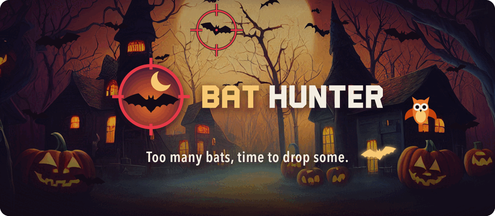

<p align="center">
  <a href="https://bat-hunter-game.web.app/" target="_blank" rel="noopener">
    
  </a>
</p>

<p align="center">
  <a href="https://bat-hunter-game.web.app/" target="_blank" rel="noopener">
    
  </a>
  <br>
  <sub>Free, in the browser, on desktop and phone. Ctrl/Cmd + click to keep this page open.</sub>
</p>

---

**Bat Hunter** is a browser shooting game born in a hackathon: the night sky is full of bats and your job is to drop as many as you can, with the best aim you can. Play alone, take the 60-second challenge, or invite a friend for a head-to-head match.

## How to play

Aim with the mouse (or tap on a phone) and shoot the bats. Every shot counts, so your **final score** is your points times your accuracy.

| Mode | What happens |
| --- | --- |
| **Free Play** | Send bats whenever you want and practice at your pace. |
| **Challenge** | 60 seconds, a full sky of bats that keeps refilling, best score wins. |
| **Multiplayer** | Create a match, share the invite link and play the same 60 seconds against a friend, with live scores, chat and the match history. |

### Difficulty

**Easy** is the classic game: regular bats, one point each. **Hard** mixes in new targets:

| Target | Points | |
| --- | --- | --- |
| Bat | +1 | The regular one. |
| Small bat | +3 | Smaller and almost twice as fast. |
| Golden bat | +10 | Rare, and it flies away after a few seconds. |
| Owl | −5 | Innocent. Don't shoot it: it costs points and counts as a miss. |

In multiplayer, the host picks the difficulty for both players.

## Tech

- **React 18** + **TypeScript** + **Vite**, styled with Sass.
- **Firebase**: Google sign-in, Realtime Database for matches, scores and chat, and Hosting.
- Pointer events for mouse, touch and pen, with a phone layout below 640px.

## Development

Requirements: Node 24 and Yarn 4 (via `corepack enable`).

```bash
yarn install
cp .env.example .env.local # fill with the Firebase web app config
yarn dev
```

Scripts: `yarn lint`, `yarn typecheck`, `yarn format` / `yarn format:check`, `yarn build`.

### Project layout

| Path | What's there |
| --- | --- |
| `src/components/` | Shared UI: buttons, cards, modal, segmented control, game panel. |
| `src/features/` | Game features: single-player dashboard, multiplayer, difficulty picker. |
| `src/services/` | The game engine (`fly-engine-service.ts`), bat types, shots, audio, Firebase. |
| `brand/` | Logo manual and the scripts that draw every brand asset. |
| `.ai/plans/` | Implementation plans. |

## Firebase

The app uses the Firebase project `bat-hunter-game`:

- **Authentication**: Google provider (`signInWithPopup`).
- **Realtime Database**: access rules live in [`database.rules.json`](database.rules.json).
- **Hosting**: the `dist/` folder, configured in [`firebase.json`](firebase.json).

To try the rules locally (requires Java):

```bash
npx firebase-tools emulators:start --only auth,database
```

## Deploy

Done by GitHub Actions ([`.github/workflows/ci.yml`](.github/workflows/ci.yml)) once lint, typecheck, format and build pass:

- Push to `main` → database rules + Hosting live channel.
- Pull request → Hosting preview channel (Google sign-in doesn't work there, since preview domains aren't authorized).

Required repository secrets:

| Secret | Value |
| --- | --- |
| `FIREBASE_SERVICE_ACCOUNT_BAT_HUNTER_GAME` | Created by `npx firebase-tools init hosting:github`. Also grant it the _Firebase Realtime Database Admin_ role in IAM. |
| `FIREBASE_PROJECT_ID` | `bat-hunter-game` |
| `VITE_FIREBASE_*` | Same values as `.env.local` (`gh secret set -f .env.local`). |

## Brand

The logo, cursors, the owl and the images in this README are drawn from code. See [`brand/README.md`](brand/README.md) and the [style guide](https://guiooak.github.io/bat-hunter-style-guide/).
